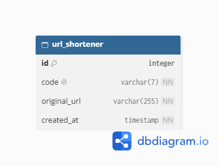

# URL Shortener

A URL shortening service built with Java 25 and Spring Boot, featuring a REST API for URL management and redirection.

> [!WARNING]
> This project is for learning and demonstration purposes and is not fully production-ready. Some management endpoints lack authentication and authorization, including the endpoint that deletes all shortened URLs. Do not expose this application publicly without appropriate security measures.

## Tech Stack

- Java 25
- Spring Boot
- Spring Web and Spring Data JPA
- PostgreSQL
- Gradle Kotlin DSL
- Docker and Docker Compose

## Key Concepts

- **Layered Architecture:** Separate controllers, services, and repositories.
- **REST API Design:** Use HTTP methods and appropriate status codes.
- **Data Persistence:** Store URL records using Spring Data JPA and PostgreSQL.
- **Validation and Exception Handling:** Validate input and handle errors with `@RestControllerAdvice`.
- **Unique Code Generation:** Generate random 7-character codes and check for collisions.
- **Containerization:** Use multi-stage Docker builds and Docker Compose.

## Database Schema


## API Endpoints

| Method   | Endpoint              | Description                  |
|----------|-----------------------|------------------------------|
| `POST`   | `/api/v1/urls`        | Create a shortened URL       |
| `GET`    | `/api/v1/urls`        | List all shortened URLs      |
| `GET`    | `/api/v1/urls/{code}` | Retrieve URL information     |
| `GET`    | `/{code}`             | Redirect to the original URL |
| `GET`    | `/health`             | Check service status         |
| `DELETE` | `/api/v1/urls/{code}` | Delete a shortened URL       |
| `DELETE` | `/api/v1/urls`        | Delete all shortened URLs    |

See [`endpoints.md`](endpoints.md) for details.

## Getting Started
**Prerequisites:** Git, Docker, and Docker Compose.

1. Clone the repository:

   ```bash
   git clone <repository-url>
   cd <project-directory>
   ```

2. Create a `.env` file with the required PostgreSQL environment variables. Use `.env.example` as a template if available.

3. Build and start the application:

   ```bash
   docker compose up --build
   ```

The API will be available at `http://localhost:8080`.
<br>
To run in the background, use `docker compose up --build -d`. Stop the services with `docker compose down`.
<br>
PostgreSQL data is persisted in a Docker volume. Removing the volume will delete the stored data.

## Security Notes
Before production use, consider adding authentication and authorization, rate limiting, stronger URL validation, safer concurrent code generation, pagination, automated tests, and monitoring.

## License
This project is licensed under the MIT License. See the [`license`](license) file for details.